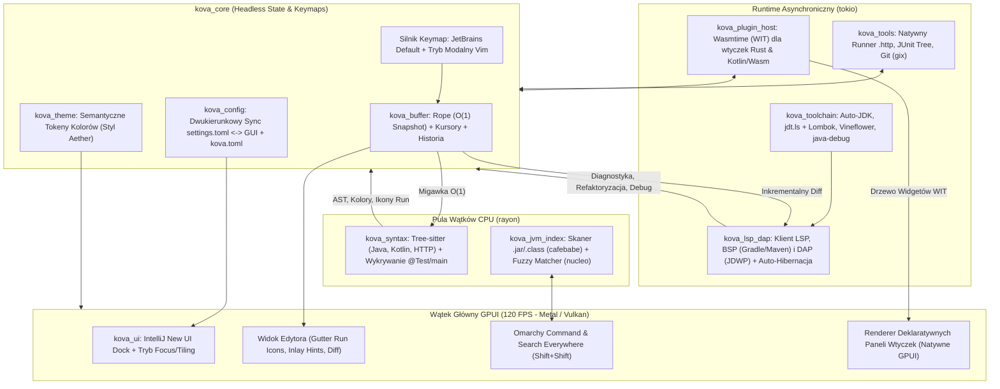

# Kova IDE — Specyfikacja Architektoniczna i Plan Wdrożenia (v1.0)

**Kova** to natywne, ultralekkie i w pełni rozszerzalne IDE dla ekosystemu JVM (Java, Kotlin, Scala), pisane od podstaw w języku **Rust** z akceleracją GPU (**GPUI**) na otwartej licencji **MIT / Apache-2.0**. Projekt łączy potęgę i wygląd **IntelliJ IDEA (New UI)** z bezkompromisową filozofią **Omarchy** (*Omakase defaults*, sterowanie z klawiatury, czystość konfiguracji i spójna estetyka).

---

## 1. Podsumowanie Zatwierdzonych Decyzji Architektonicznych

| Obszar | Zatwierdzona decyzja projektowa (v1.0) |
| :--- | :--- |
| **Nazwa i Licencja** | **Kova** (`kova_*`), czysty `Cargo Workspace` od podstaw, licencja dualna **MIT / Apache-2.0**. |
| **Warstwa UI i OS** | **GPUI** (120 FPS GPU, kontekstowe Akcje, Keymapy i Fokusy). Priorytet: **macOS (Metal) + Linux (Wayland/X11 - Vulkan)**; Windows w kolejnym etapie. |
| **Języki w MVP** | **Java jako priorytet #1** (pełna semantyka `jdt.ls` + automatyczny `lombok.jar` + Gradle/Maven) + składnia **Kotlina** (m.in. dla `build.gradle.kts`). Pełna semantyka Kotlina i Scali (Metals) zaraz po ustabilizowaniu Javy. |
| **Silnik JVM (Hybryda)** | Natywny indeks w Rust (`tree-sitter` + parsowanie `.jar`/`.class` przez `cafebabe` + sygnatury bajtkodu) dla nawigacji w <1 s + `jdt.ls` uruchamiany leniwie z limitem RAM i **auto-usypianiem nieaktywnych projektów**. |
| **UX i Tryby Pracy** | **IntelliJ New UI** (dokowalne *Tool Windows*, zakładki) + przełączany jednym skrótem tryb **Focus / Tiling** (w duchu Hyprland/Omarchy) + domyślna **Keymapa JetBrains** oraz wbudowany opcjonalny **tryb modalny Vim (ala IdeaVim)**. |
| **Pakiet „JVM Omakase”** | W pudełku: **Git**, graficzny runner **JUnit**, **Debugger (DAP/JDWP)**, automatyczny dekompilator `.class` na żądanie (**Vineflower**) oraz lekki runner plików **`.http`**. Bazy danych, Docker i chmura — jako wtyczki WASM. |
| **Konfiguracja i Pliki** | Dotfiles w `~/.config/kova/settings.toml` **dwukierunkowo zsynchronizowane** z GUI (`Cmd+,`). **Zero śmieci `.idea/`** — stan roboczy w `~/.cache/kova/`, a w repozytorium opcjonalnie tylko pojedynczy plik **`kova.toml`**. |
| **Rozszerzalność** | Sandbox **WASM (`wasmtime` + WIT)** z **deklaratywnym API natywnych widgetów GPUI** (drzewka, tabele, formularze — **zero WebView!**) oraz oficjalnym Plugin SDK dla **Rust** i **Kotlin/Wasm**. |
| **Polityka AI** | **Zero-Bloat Core** — rdzeń w 100% wolny od przycisków AI i telemetrii. Funkcje AI dostępne wyłącznie jako opcjonalna oficjalna wtyczka WASM (BYOK / modele lokalne / ACP) korzystająca ze standardowego API AST/JVM. |

---

## 2. Budżety Wydajnościowe i Doktryna Produktu

1. **Zimny start okna do gotowości edycji:** `< 120 ms`
2. **Zużycie pamięci RAM przez proces Kova (Rust + GPUI + indeksy lokalne):** `< 150 MB`
3. **Opóźnienie wprowadzania znaku (Input Latency):** `< 5 ms` (wątek renderowania GPUI nigdy nie wykonuje operacji dyskowych ani nie czeka na odpowiedź LSP)
4. **Gotowość nawigacji *Go to Class* po otwarciu projektu:** `< 1.5 s` (dzięki natywnemu skanerowi `.java`/`.kt` oraz `.jar` w Rust przed startem JVM)
5. **Auto-hibernacja JVM:** Jeśli okno projektu pozostaje w tle bez aktywności przez zadany czas (np. 15 minut), Kova zapisuje stan diagnostyki i usypia proces `jdt.ls`, zwalniając pamięć operacyjną systemu, a przy powrocie do edycji budzi go transparentnie w tle.

> [!IMPORTANT]
> Reguła **Headless Core**: Wszystkie crate'y poza `kova_ui` i `kova_app` muszą kompilować się i przechodzić testy integracyjne bez inicjalizacji okna graficznego. Pozwala to testować automatycznie cały przepływ edycji, emulacji Vima, indeksowania `.jar` i komunikacji z `jdt.ls` w ułamku sekundy.

---

## 3. Architektura Systemu i Przepływ Danych

Kova wykorzystuje niemutowalne migawki tekstu `ropey::Rope` (klonowane w czasie $O(1)$ przez współdzielone drzewo `Arc`), aby bez blokad zasilać wątki robocze CPU (`rayon`), asynchroniczne protokoły (`tokio`) oraz sandbox wtyczek (`wasmtime`).



---

## 4. Struktura Katalogów i `Cargo Workspace`

### 4.1. Ścieżki w systemie użytkownika (Czystość w stylu Omarchy)

```text
~/.config/kova/
├── settings.toml          # Główna konfiguracja (czytelna dla człowieka i wersjonowalna w dotfiles)
├── keymap.toml            # Nadpisania skrótów klawiszowych
└── themes/                # Motywy TOML (domyślnie: kova-islands-dark.toml, kova-light.toml)

~/.local/share/kova/
├── omakase/               # Zarządzane automatycznie narzędzia JVM:
│   ├── jdks/              # Pobrane dystrybucje Temurin / GraalVM (opcjonalnie)
│   ├── jdtls/             # Eclipse JDT.LS + skonfigurowany agent lombok.jar
│   ├── java-debug/        # Adapter debugowania JDWP dla protokołu DAP
│   └── vineflower/        # Dekompilator .class uruchamiany na żądanie dla bibliotek bez źródeł
└── plugins/               # Zainstalowane paczki wtyczek .wasm (np. kova-ai, kova-database, kova-scala)

~/.cache/kova/
└── workspaces/<hash>/     # Lokalny stan otwartych kart, historia i binarny cache indeksu .jar (poza repozytorium!)
```

W samym katalogu projektu użytkownika **nie powstaje żaden ukryty folder**; jedynie na życzenie użytkownika tworzony jest pojedynczy, czytelny plik `kova.toml` (np. ze współdzielonymi w zespole konfiguracjami uruchomieniowymi Spring Boot / Gradle).

### 4.2. Układ `Cargo.toml` w repozytorium Kova

```toml
[workspace]
resolver = "2"
members = [
    "crates/kova_app",          # Binarka startowa, inicjalizacja GPUI i pętli zdarzeń
    "crates/kova_core",         # Zarządzanie projektem, Akcje, Keymapa JetBrains + silnik modalny Vim
    "crates/kova_config",       # Parser/serializer z zachowaniem komentarzy (toml_edit) dla settings.toml i kova.toml
    "crates/kova_theme",        # System tokenów Aether (UI + Tree-sitter + Terminal + Wtyczki)
    "crates/kova_buffer",       # Bufor tekstu (ropey), wielokursory, zaznaczenia, drzewo Undo/Redo
    "crates/kova_syntax",       # Tree-sitter (Java, Kotlin, HTTP, TOML, JSON) + zapytania o punkty startowe (@Test/main)
    "crates/kova_jvm_index",    # Indeks symboli projektu, parser bajtkodu .jar/.class (cafebabe) i fuzzy search (nucleo)
    "crates/kova_toolchain",    # Menedżer "Omakase": detekcja JDK, pobieranie jdt.ls, Lombok, Vineflower, java-debug
    "crates/kova_lsp_dap",      # Asynchroniczny mostek LSP, BSP i DAP z polityką limitów RAM i auto-usypiania JVM
    "crates/kova_tools",        # Pakiet narzędzi JVM: Git (gix), runner plików .http, model wyników JUnit, Terminal PTY
    "crates/kova_plugin_host",  # Sandbox Wasmtime + kontrakty WIT + mostek deklaratywnego UI
    "crates/kova_ui",           # Komponenty GPUI: IntelliJ New UI Dock, Focus/Tiling Layout, Edytor, Okno Ustawień
    "sdk/kova_plugin_rs",       # Oficjalne SDK w Rust do pisania wtyczek WASM
]
```

> [!TIP]
> W `kova_config` użyjemy biblioteki **`toml_edit`** zamiast zwykłego `toml`. Dzięki temu, gdy użytkownik zmieni przełącznik w graficznym oknie Ustawień (`Cmd+,`), Kova zaktualizuje konkretną wartość w `~/.config/kova/settings.toml` **zachowując wszystkie ręczne komentarze i formatowanie użytkownika** w jego dotfiles!

---

## 5. Kontrakt Rozszerzalności WASM + Deklaratywne UI (Rust & Kotlin/Wasm)

Aby wtyczki mogły dodawać pełnoprawne *Tool Windows* (np. eksplorator bazy danych, podgląd beanów Springa czy asystenta AI) bez kosztownego WebView, `kova_plugin_host` definiuje w **WIT (WebAssembly Interface Types)** lekki protokół deklaratywnych widoków renderowanych natywnie przez GPUI:

* **Komponenty bazowe dostępne dla wtyczek:** `Split`, `Tabs`, `Tree`, `Table` (z wirtualizacją wierszy!), `List`, `Form` (`TextInput`, `Select`, `Toggle`, `Button`), `CodeBlock` (z kolorowaniem Tree-sittera Kova!), `Markdown`, `Badge`.
* **Izolacja i stylizacja:** Wtyczka operuje wyłącznie na semantycznych wariantach stylu (`primary`, `muted`, `warning`, `error`, `accent`) — nigdy nie podaje surowych pikseli ani kolorów HEX, co gwarantuje 100% spójności z aktywnym motywem Kova.
* **Wsparcie dla Kotlin/Wasm:** Kontrakt WIT oraz warstwa komunikacyjna są projektowane tak, aby oprócz `sdk/kova_plugin_rs` (Rust) udostępnić generator wiązań dla **Kotlin/Wasm (WASI)** — otwierając tworzenie wtyczek dla całej społeczności programistów JVM w ich natywnym języku.

---

## 6. Harmonogram Wdrożenia (Kamienie Milowe)

### Faza 0: Fundament GPUI, Konfiguracja TOML i Bufor Tekstu (Tydzień 1–2)
1. Inicjalizacja `Cargo Workspace`, konfiguracja GPUI na macOS (Metal) i Linux (Wayland/X11).
2. Implementacja `kova_config` (`toml_edit` + watcher plików dla żywego przeładowywania `settings.toml` i motywów `kova_theme`).
3. Implementacja `kova_buffer` (`ropey`, wielokursory, schowek, Undo/Redo) wraz z kompletem testów jednostkowych *headless*.
4. Wyświetlenie pierwszego płynnego widoku edytora tekstu w 120 FPS w kolorystyce *Kova Islands Dark*.

### Faza 1: UX „IntelliJ × Omarchy”, Vim i Błyskawiczna Składnia (Tydzień 3–5)
1. Budowa powłoki `kova_ui`: układ **IntelliJ New UI** (paski boczne *Project* i *Structure*, dolny panel, karty edytora) oraz przełącznik trybu **Focus / Tiling** sterowanego w 100% z klawiatury.
2. Wdrożenie domyślnej **Keymapy JetBrains** oraz wbudowanego przełącznika **trybu modalnego Vim** w `kova_core`.
3. Podpięcie `kova_syntax` (`tree-sitter-java`, `tree-sitter-kotlin`, `tree-sitter-http`): kolorowanie składni, zwijanie kodu oraz klikalne ikony `▶` przy metodach `main` i `@Test`.
4. Centralne okno **Omarchy Command & Search Everywhere (`Shift+Shift`)** oparte o `nucleo` + graficzne okno Ustawień (`Cmd+,`) dwukierunkowo spięte z `settings.toml`.

### Faza 2: „Omakase JVM” — Indeks `.jar` w Rust, JDT.LS i Vineflower (Tydzień 6–9)
1. Moduł `kova_jvm_index`: wielowątkowy skaner źródeł i archiwów `.jar` (`cafebabe` + `zip`) zapisujący szybki cache w `~/.cache/kova/workspaces/` — natychmiastowe *Go to Class* w <1.5 s po otwarciu projektu.
2. Moduł `kova_toolchain`: automatyczna detekcja JDK (SDKMAN / systemowe / pobieranie Temurin) oraz bezobsługowa instalacja `jdt.ls` (z podpiętym `lombok.jar`) i dekompilatora **Vineflower** w `~/.local/share/kova/omakase/`.
3. Moduł `kova_lsp_dap` (część LSP): autouzupełnianie, *Inlay Hints*, *Quick Fixes* (`Alt+Enter`), refaktoryzacja *Rename* (`Shift+F6`), automatyczna dekompilacja klas bibliotek przy *Go to Definition* oraz mechanizm **auto-usypiania nieaktywnych procesów `jdt.ls`**.

### Faza 3: Narzędzia „JVM Omakase” — Build, JUnit, Debugger, Git i `.http` (Tydzień 10–14)
1. Wbudowany terminal (`alacritty_terminal` + `portable-pty`) z automatycznym wstrzykiwaniem `JAVA_HOME` projektu i kolorami motywu Kova.
2. Integracja z Gradle / Maven (BSP + obsługa `kova.toml` dla współdzielonych *Run Configurations*) oraz graficzny panel **JUnit Test Runner** z drzewkiem testów i klikalnymi stacktrace'ami.
3. Pełny **Debugger JVM** (DAP -> `java-debug` / JDWP): breakpointy warunkowe, podgląd stosu wątków i zmiennych, *Evaluate Expression* (`Alt+F8`).
4. Natywny **runner plików `.http`** (wykonywanie zapytań REST prosto z edytora z podglądem sformatowanej odpowiedzi JSON/ nagłówków w panelu obok) oraz integracja **Git** (`gix`: diff na marginesie, *Git Blame*, panel Commit `Cmd+K`).

### Faza 4: Rozszerzalność WASM, SDK (Rust + Kotlin/Wasm) i Ekosystem (Tydzień 15+)
1. Implementacja `kova_plugin_host` (`wasmtime` + WIT) wraz z natywnym rendererem deklaratywnych widgetów GPUI i systemem uprawnień `plugin.toml`.
2. Wydanie `sdk/kova_plugin_rs` oraz szablonu startowego dla **Kotlin/Wasm**.
3. Stworzenie pierwszych zewnętrznych pakietów udowadniających dojrzałość API (bez obciążania rdzenia):
   * rozszerzone pakiety semantyczne **Kotlin LSP** oraz **Scala (Metals)**,
   * opcjonalna oficjalna wtyczka **Kova AI** (BYOK / Ollama / ACP),
   * wtyczka **Kova Database** (wykorzystująca deklaratywną wirtualizowaną tabelę GPUI).
